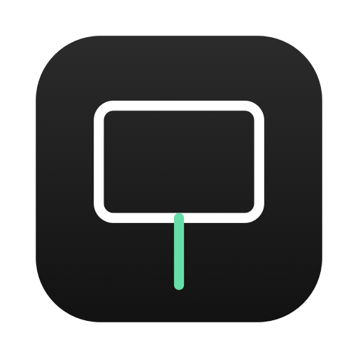
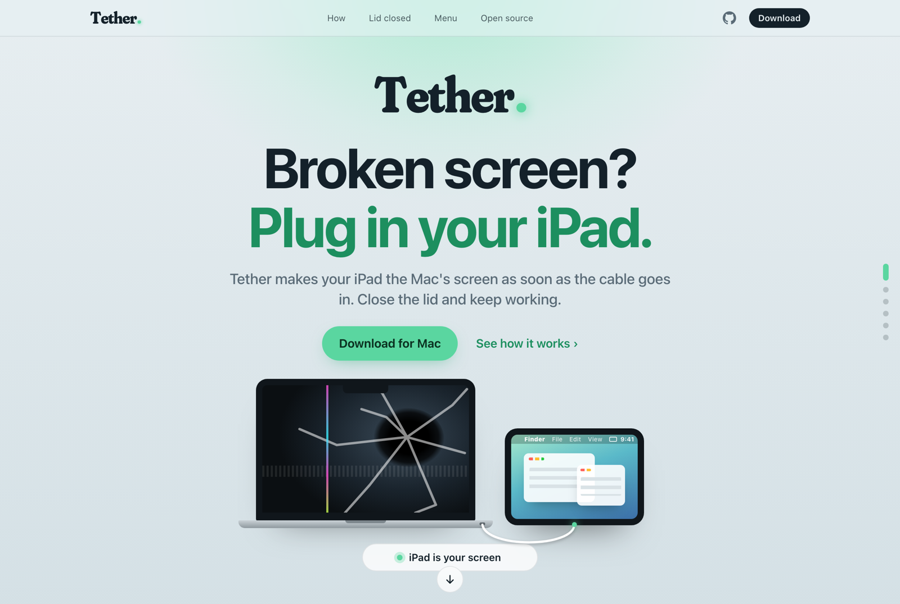

<p align="center">
  
</p>

<h1 align="center">Tether</h1>

<p align="center">
  <b>Broken screen? Plug in your iPad.</b><br>
  Tether makes your iPad the Mac's screen: Sidecar on the cable, Sill without it.<br>
  Close the lid and keep working. Put it in a bag and it sleeps.
</p>

<p align="center">
  <a href="https://github.com/rzrizaldy/tether/releases/latest/download/Tether.zip"><b>Download for Mac</b></a> ·
  <a href="https://rzrizaldy.github.io/tether/">Website</a> ·
  <a href="#build-it-yourself">Build it yourself</a>
</p>

<p align="center">
  
  
  
  
</p>

<picture>
  <source media="(prefers-color-scheme: dark)" srcset="docs/img/hero-dark.png">
  
</picture>

## Why

My MacBook's screen broke. The Mac still works, and I have an iPad. Sidecar can already use an iPad as a display, but you start it from Control Center, and you can't click Control Center on a screen you can't see. Then if you close the lid, the Mac goes to sleep.

Tether is the hub that fixes it. It picks how the iPad shows your Mac, keeps the Mac awake with the lid shut while you're using it, and lets it sleep the moment you're not.

## How it works

Tether decides by one thing: is the cable in?

```
                  ┌─────────────── Tether (menu bar) ───────────────┐
 cable in   ───▶  │  Sidecar over USB · iPad is the main display     │
                  │  Mac pointer drawn on the iPad · lid can close   │
                  │                                                  │
 no cable   ───▶  │  Sill over Wi-Fi, or Tailscale from away         │
                  │  iPad-sized Retina screen · awake on a charger   │
                  │                                                  │
 in a bag   ───▶  │  nothing to hold on to · the Mac sleeps          │
                  └──────────────────────────────────────────────────┘
```

### With the cable: Sidecar

The look closest to a real Mac screen.

| | |
|---|---|
| **The cable is the switch** | Tether watches USB. When an iPad shows up, it turns on Sidecar and forces it over the cable. If the iPad is locked, it keeps trying until you unlock it. |
| **The menu bar moves** | The iPad becomes the main display, so the Dock and new windows open there, not on the broken screen. |
| **You can see the pointer** | Sidecar hides the Mac's pointer on the iPad. Tether draws the Mac's own pointer there (arrow, I-beam, hand) at your usual size. |
| **Close the lid** | A Mac sleeps when you close the lid unless a monitor is plugged in, and macOS doesn't count an iPad as one. Tether keeps it awake while Sidecar is on. |

Type on the iPad's keyboard. To point, use touch, Apple Pencil, or a mouse connected to the Mac: Sidecar doesn't pass the iPad's trackpad through.

### Without the cable: Sill

For the couch, or for reaching the Mac at home from somewhere else. [Sill](https://getsill.app) is a free, open-source app that streams your Mac to the iPad and passes the iPad's trackpad, keys and Pencil through. Turn on **Remote and wireless with Sill** in Tether's menu, and when no cable is in, Tether:

- makes an **iPad-sized Retina screen** (1180×820 at 2×, with More Space options in System Settings › Displays), so Sill's Desktop has a proper screen even with the lid shut and the real one broken;
- **keeps the Mac awake with the lid shut, only while it's on a charger**;
- **opens Sill** so it's ready to stream.

Plug the cable back in and Sidecar takes over again.

### In a bag: it sleeps

Tether only holds the Mac awake while it's in use, and lets go when:

- **the cable comes out** (Sidecar), or **the charger does** (Sill);
- **Sidecar is gone for 90 seconds**, for example because the iPad's screen turned off;
- **the Mac runs hot**, **the battery reaches 10%**, or **nobody has touched it for 5 minutes on battery**, even with everything still plugged in;
- **you quit Tether**, and on the next launch if it ever crashed.

Other apps that "prevent sleep" only stop *idle* sleep, which closing the lid ignores. The one exception Tether respects is [Amphetamine](https://apps.apple.com/app/amphetamine/id937984704): if it already keeps the Mac up, Tether doesn't take over, and while an Amphetamine session runs, Tether never switches its keep-awake off.

It lives in the menu bar. There's no window, no Dock icon and no settings screen, and it opens at login.

```
Your iPad · Connected
Lid can be closed
───────────────────────────────
Disconnect
───────────────────────────────
✓ Auto-connect on cable
✓ Work with lid closed
✓ iPad as main display
✓ Show pointer on iPad
  Remote and wireless with Sill
✓ Open at login
───────────────────────────────
Open Log
Quit Tether                  ⌘Q
```

## Install

1. **[Download Tether.zip](https://github.com/rzrizaldy/tether/releases/latest/download/Tether.zip)**, unzip it and drag **Tether** into Applications.
2. **Allow it once.** Tether isn't notarized, so macOS stops the first open. Go to System Settings › Privacy & Security, scroll down and click **Open Anyway**. Or run this in Terminal:
   ```bash
   xattr -dr com.apple.quarantine /Applications/Tether.app
   ```
3. **Turn on lid closed.** Click the iPad icon in the menu bar, choose **Work with lid closed…** and type your password. Do this once, while you can still see a screen.

That's the cable. For the no-cable side, also:

4. **Install [Sill](https://getsill.app)** on the Mac (`brew install --cask saffsanity/sill/sill`) and on the iPad (App Store). Give Sill Screen Recording and Accessibility, and pair the iPad once.
5. **From away:** install [Tailscale](https://tailscale.com) on both, turn on **Remote Access** in Sill's Settings, and connect once at home so the iPad learns the way.
6. In Tether's menu, turn on **Remote and wireless with Sill**.

### You'll need

- An iPad that supports Sidecar (iPadOS 13 or later), signed in to the same Apple ID as the Mac. The iPad has to trust the Mac the first time you plug it in.
- macOS 13 or later. Built and tested on macOS 27. Sill needs macOS 14 and iPadOS 17.

### Good to know

- **After a restart you'll be unlocking blind.** Neither Sidecar nor Sill can show the Mac's first login screen. Open the lid and use Touch ID, or type your password without seeing it.
- **Sidecar over the cable** also charges the iPad from the Mac.
- **If it doesn't connect**, choose **Open Log** in the menu. Every plug-in, connect attempt and sleep decision is written to `~/Library/Logs/Tether.log`. Paste it into an issue.
- **Plugging in just to charge?** Untick **Auto-connect on cable** at home, or the iPad becomes your screen every time.
- **Tether uses private macOS frameworks** for Sidecar and the virtual screen, the same ones Control Center and Sill use. A future macOS update could break them. If that happens, [open an issue](https://github.com/rzrizaldy/tether/issues).

## The password, exactly

Keeping a Mac awake with the lid shut needs `pmset disablesleep`, and that needs root. Turning on **Work with lid closed…** installs this one line at `/etc/sudoers.d/tether`, after `visudo` checks it:

```
you ALL=(root) NOPASSWD: /usr/bin/pmset -a disablesleep 0, /usr/bin/pmset -a disablesleep 1
```

That lets Tether switch that one setting on and off, with no other root access. Tether makes no network requests, collects nothing and has no account. (It runs Tailscale's own command on your Mac to show whether it's connected, and that's all.)

## Uninstall

```bash
rm -rf /Applications/Tether.app && sudo rm -f /etc/sudoers.d/tether && sudo pmset -a disablesleep 0
```

Then remove it from System Settings › General › Login Items if it's still listed.

## Build it yourself

Needs the Xcode command-line tools.

```bash
git clone https://github.com/rzrizaldy/tether.git
cd tether
./scripts/build.sh --install
```

`./scripts/build.sh` alone builds `build/Tether.app` (universal), `--install` copies it to Applications and opens it, and `--zip` writes `build/Tether.zip` and its `.sha256` for a release.

### Layout

- [`Sources/App.swift`](Sources/App.swift): the menu bar, and the logic that decides when to connect and when to keep the Mac awake.
- [`Sources/Sidecar.swift`](Sources/Sidecar.swift): connects and disconnects through `SidecarCore`.
- [`Sources/USBWatcher.swift`](Sources/USBWatcher.swift): IOKit notifications for an iPad on USB.
- [`Sources/System.swift`](Sources/System.swift): the lid-closed switch (`pmset`), the lid, battery and idle readings for the bag guard, and moving the main display.
- [`Sources/PadPointer.swift`](Sources/PadPointer.swift): draws the Mac's pointer on the iPad, which Sidecar hides.
- [`Sources/Remote.swift`](Sources/Remote.swift), [`Sources/Private.h`](Sources/Private.h): the iPad-sized virtual Retina screen (`CGVirtualDisplay`) for Sill, and the charger and Tailscale checks. Without Sill, a Screen Sharing route sits behind ⌥ in the menu.
- [`Sources/Log.swift`](Sources/Log.swift): the log at `~/Library/Logs/Tether.log`.
- [`docs/`](docs): the website, served by GitHub Pages.
- [`scripts/`](scripts): `build.sh` and `make-icon.swift`.

## Checking a download

Each release attaches `Tether.zip.sha256`. Compare it with your copy:

```bash
shasum -a 256 ~/Downloads/Tether.zip
```

## License

[MIT](LICENSE). Made for the Mac with a cracked screen.
